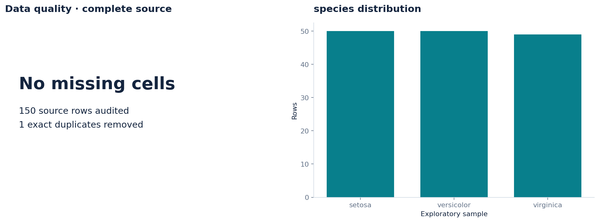
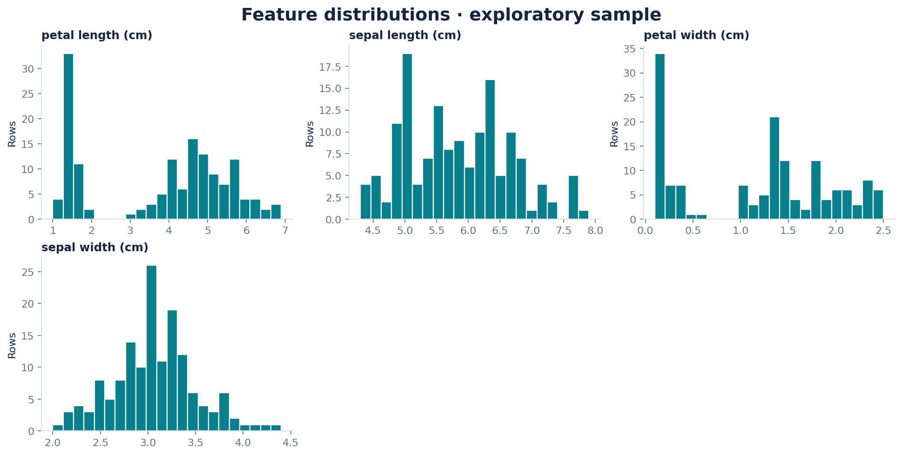
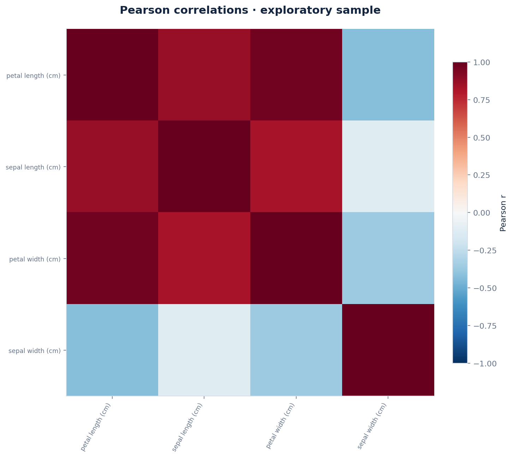

# التحليل الاستكشافي لقياسات أزهار السوسن

دراسة وصفية لاختلاف قياسات الأزهار بين ثلاثة أنواع، باستخدام أربعة قياسات لطول وعرض الكأس والبتلة.

تحتوي البيانات المنظّفة على 149 سجلًا بعد استبعاد تكرار واحد، دون خلايا مفقودة. بلغ أقوى ارتباط مطلق بين طول البتلة وعرضها 0.963.

السؤال استكشافي؛ لا يوجد نموذج تنبؤ مختار أو اختبار محفوظ لقياس دقته. الارتباط في البيانات لا يثبت علاقة سببية.

## الرسوم والنتائج المرئية

الرسوم محفوظة من التنفيذ الأصلي. تعريب هذه الصفحة لا يغيّر بياناتها أو تسميات الصور داخل الملفات.

## الملفات المرجعية

- [مقاييس التقييم والنتائج](metrics.json).
- [بيانات التدقيق وبيئة التنفيذ](audit.json).
- [مصدر البيانات وشروط الترخيص](SOURCE.md).
- [دفتر شرح التحليل](analysis.ipynb).
- [ملاحظات المراجعة البشرية](LEARNING_NOTES.md).

## المصادر والإسناد

- [مصدر 1: UCI Machine Learning Repository — Iris Dataset](https://archive.ics.uci.edu/dataset/53/iris).

[المرجع التقني الإنجليزي الكامل](README.en.md) يحفظ تفاصيل النسخة الأصلية. تُترك أسماء الملفات والأوامر ومعرّفات النماذج والمقاييس بصيغتها التقنية لضمان تطابقها مع الكود.
